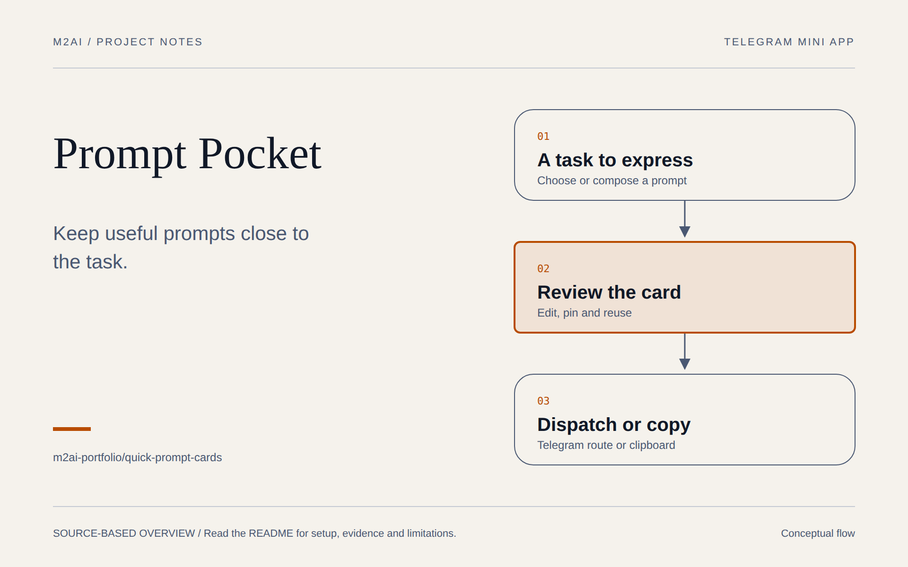

# Prompt Pocket



The useful prompt is usually buried in a previous chat just when you need it again. Prompt Pocket gives it a small, editable home on your phone: start from one useful example, write your own, pin it, and choose whether to send it through a configured Telegram bot or copy it into another tool.

The app also guides you through defining an automation with Silver Pocket. It helps shape the job before you choose an LLM provider or build the integration.

**[Open the app](https://m2ai-portfolio.github.io/quick-prompt-cards/)**

## What is included

- A React/TypeScript Mini App with search, categories, prompt composition, and review before saving.
- Device-local pins and edits, with confirmation before deletion.
- Clipboard fallback when opened outside a supported Telegram launch.
- Silver Pocket's guided questions, with local save and resume.
- A separate Node.js API for Telegram validation, prompt dispatch, and a shared per-user pocket.
- Contracts and tests for session handling, sync, import, and failure behavior.

The browser app does not contain model credentials or bot tokens. Sending a prompt to Telegram is not proof that a downstream assistant has completed the requested work.

## Run the browser app

Use a Node.js release supported by the checked-in Vite dependency. Its lockfile requires Node `^20.19.0 || >=22.12.0`. The optional server also needs a release where `node -e "require('node:sqlite')"` succeeds; the provided Dockerfile uses `node:22-alpine` and checks that import during its build. Git and npm are required.

```bash
git clone https://github.com/m2ai-portfolio/quick-prompt-cards.git
cd quick-prompt-cards
npm ci
npm run dev
```

The development server binds to all interfaces. On the author's ProBook, the default Vite port is accessible at [10.0.0.46:5173](http://10.0.0.46:5173); use the printed port if Vite chooses another. On another machine, use that machine's address.

A plain browser launch works with device-local storage and clipboard fallback. A successful local UI does not require configuring a Telegram bot.

## First walkthrough

1. Open the starter card and inspect its text.
2. Choose **Create a prompt**, fill in the details, and review before saving.
3. Pin a prompt, reload the app, and confirm it remains on the same browser/device.
4. Use **GO**. In a plain browser, follow the explicit copy path; a validated Telegram launch can use the dispatch service.
5. Open Silver Pocket, answer several questions, close it, and resume the saved draft.

Silver Pocket defines an automation; it does not automatically deploy the resulting workflow. Browser-local records are specific to the device and browser profile.

## Optional Telegram sync and dispatch

The full Telegram path requires your own bot configuration, HTTPS hosting, a reachable API, and persistent server storage. The sample bot names `hermes1` and `beth` describe the author's deployment; they are not accounts supplied to a new installation.

1. Read [server/DEPLOYMENT.md](server/DEPLOYMENT.md) and [the shared-pocket contract](contracts/shared-pocket-v1.md).
2. Configure the server through your approved environment or secret manager. `PROMPT_POCKET_BOTS` lists allowed bot keys. Each key needs `PROMPT_POCKET_BOT_<KEY>_TOKEN`; `PROMPT_POCKET_DATA_DIR` must point to a writable persistent directory. See [server/bot-registry.ts](server/bot-registry.ts) for key normalization.
3. Set `ALLOWED_ORIGIN` to the frontend origin and `PORT` as appropriate. The server default is `8787`. Setting `PROMPT_POCKET_DISPATCH_DISABLED` disables dispatch while you validate other behavior.
4. Build and start the API:

   ```bash
   npm run build:server
   npm run start:server
   ```

5. Configure `VITE_PROMPT_POCKET_API_BASE` for the frontend at build time. `VITE_PROMPT_RUN_ENDPOINT` is the older v1 rollback path. These values are public URLs, never tokens. Supply them through your build environment; review the checked-in deployment defaults before hosting your own copy.
6. In BotFather, point your bot's Mini App menu button to your HTTPS frontend with its configured `?bot=` key. Test from that bot in Telegram.

On ProBook, source `~/.env.shared` before launching authorized integrations. Do not put secrets into `VITE_*` values or commit them to the repository.

A first synced launch asks before importing local pins or edits. If a server write fails, the client should keep your text and ask you to retry. Verify import, cross-device readback, and dispatch separately; these are distinct parts of the workflow.

## Build and check changes

```bash
npx tsc -b --noEmit
npm run typecheck:server
npm test
npm run lint
npm run build
```

The frontend build writes to `docs/` for GitHub Pages. Preserve any documentation assets outside generated output when rebuilding. `npm run format` is available to apply formatting, and `npm audit` can inspect dependency advisories. Publishing is separate from building.

## Source map

| Path | Purpose |
|---|---|
| [shared/prompt-catalog.ts](shared/prompt-catalog.ts) | Canonical starter prompt |
| [src/prompts.ts](src/prompts.ts) | Client cards and delivery metadata |
| [src/prompt-creator.ts](src/prompt-creator.ts) | Personal prompt composition |
| [src/workflows/silver-pocket/definition.ts](src/workflows/silver-pocket/definition.ts) | Provider-neutral automation questions |
| [shared/pocket-contract.ts](shared/pocket-contract.ts) | Shared record types and limits |
| [server/](server/) | Telegram adapter, sessions, persistence, and tests |
| [contracts/](contracts/) | Prompt-run, workflow-state, and sync contracts |

Silver Pocket uses workflow ID `silver-pocket` and schema version `2.0`. It starts fresh instead of executing or uploading older Silver Platter records.

Built by Matthew Snow / [M2AI](https://memyselfplusai.com). React, Vite, and Telegram are third-party components. No license file is included in this snapshot. Deployment health and actual Telegram delivery must be checked in the environment where you run it.
